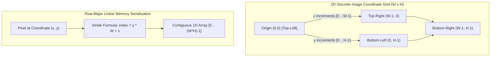
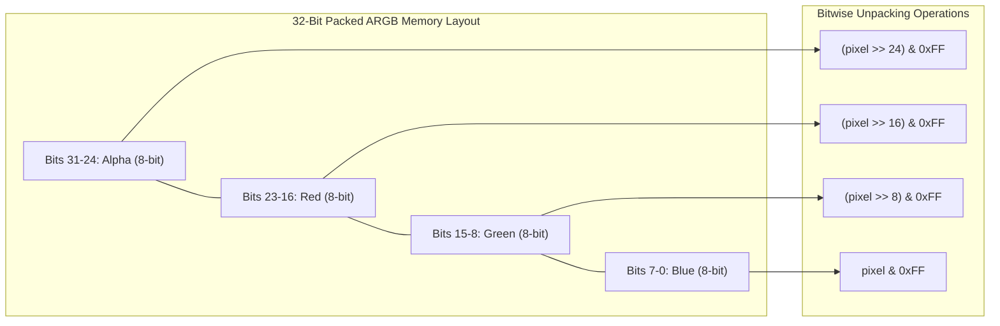
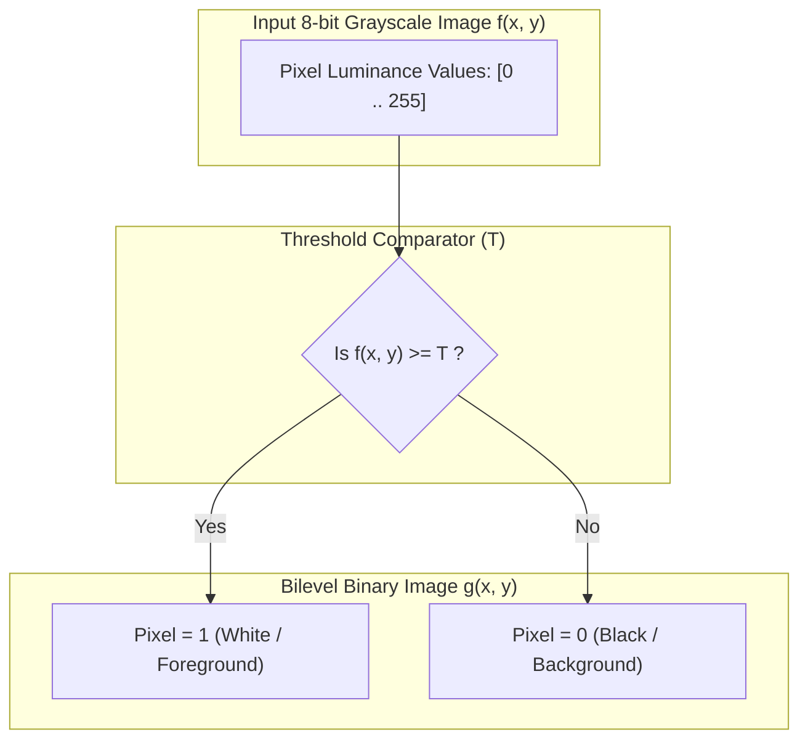
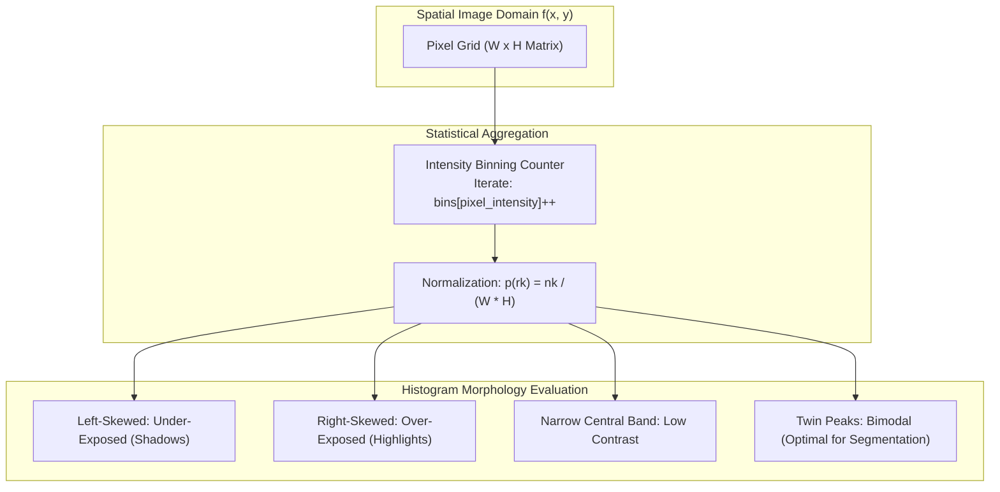
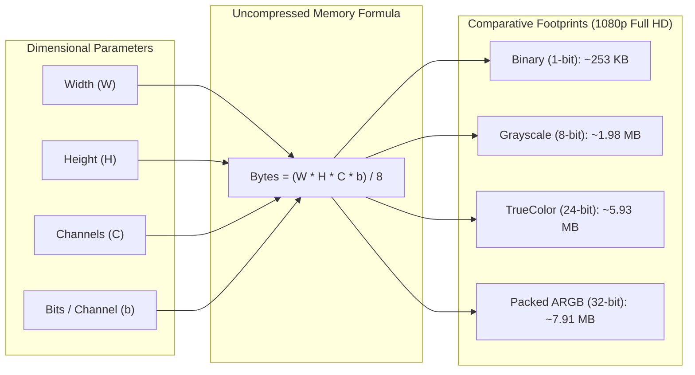

# 📝 Class Notes

### Topic 1: Digital Image Representation, Spatial Dimensions, and Pixel Anatomy
In digital image processing, a continuous physical scene is modeled computationally as a discrete two-dimensional spatial intensity matrix $I(x, y)$ or $f(x, y)$, where $x$ and $y$ represent discrete spatial coordinates on an orthogonal grid. The spatial resolution of a digital image is bounded by its dimensional extent: width ($W$, columns along the horizontal $x$-axis) and height ($H$, rows along the vertical $y$-axis), yielding a total count of $N = W \times H$ discrete picture elements, commonly referred to as **pixels**. Following standard graphics and computer vision conventions, the spatial coordinate origin $(0, 0)$ resides at the top-left vertex of the image plane. The horizontal index $x$ increments from $0$ to $W - 1$ from left to right, while the vertical index $y$ increments from $0$ to $H - 1$ downwards.

At each coordinate $(x, y)$, a pixel encapsulates an amplitude or quantized numerical value corresponding to physical light radiance, luminance, or chromatic spectral reflectance. In computer memory, two-dimensional image matrices are stored in contiguous, flat one-dimensional linear arrays (row-major order) to maximize hardware cache spatial locality and vectorization during convolutional filtering. The linear memory index for any spatial coordinate pair $(x, y)$ in an image with width $W$ is mapped via the canonical stride equation:
$$\text{Index}_{1D} = y \times W + x$$
The bit depth $b$ (bits per pixel, bpp) dictates the range of quantifiable discrete intensity levels $L = 2^b$. A higher bit depth increases intensity resolution and tonal gradation, while higher spatial dimensions increase geometric fidelity and fine detail capture.

### Topic 2: Color Space Models & 24-Bit RGB vs 32-Bit ARGB Packed Representation
The **RGB color model** is an additive color system rooted in Young-Helmholtz trichromatic human vision theory, where colors are synthesized by superimposing primary light beams of Red ($R$), Green ($G$), and Blue ($B$). In standard digital representations, each primary color channel is discretized into an 8-bit unsigned integer spanning the domain $[0, 255]$:
* $(0, 0, 0)$ corresponds to the complete absence of light (**Black**).
* $(255, 255, 255)$ represents the maximum chromatic saturation across all three primaries (**White**).
* Intermediate equal values (e.g., $(128, 128, 128)$) produce neutral mid-spectrum **Grays**.

In **24-bit TrueColor** representations, assigning 8 bits to each of the three channels yields $2^8 \times 2^8 \times 2^8 = 2^{24} = 16,777,216$ distinguishable color permutations—surpassing the perceptual threshold of the human eye. In Java's graphics pipelines (`BufferedImage.TYPE_INT_RGB` and `TYPE_INT_ARGB`), memory throughput is optimized by packing multiple color channels into a single 32-bit signed integer primitive (`int`). In 32-bit ARGB representations, an 8-bit **Alpha** ($\alpha$) transparency channel is prepended to the RGB triplet:
$$\text{Pixel}_{32} = (\alpha \ll 24) \mid (R \ll 16) \mid (G \ll 8) \mid B$$
Extracting and isolating individual color channels from packed integers is achieved using fast bitwise right-shift and logical AND masking operations:
* $\text{Alpha} = (\text{pixel} \gg 24) \mathrel{\&} \text{0xFF}$
* $\text{Red} = (\text{pixel} \gg 16) \mathrel{\&} \text{0xFF}$
* $\text{Green} = (\text{pixel} \gg 8) \mathrel{\&} \text{0xFF}$
* $\text{Blue} = \text{pixel} \mathrel{\&} \text{0xFF}$

### Topic 3: Binary (Bilevel / Monochrome) Images & Thresholding Mechanics
A **binary image** (also called a monochrome, 1-bit, or bilevel image) is a degenerate class of digital image where each pixel is constrained to strictly one of two possible discrete states: $0$ (Black / Background) or $1$ (White / Foreground). Unlike 8-bit grayscale images that express 256 gradations of luminance, or 24-bit color images that capture millions of colors, binary images store purely topological and geometric shape data. Binary images are fundamental in optical character recognition (OCR), barcode recognition, medical cell segmentation, fingerprint analysis, and morphological filtering (dilation, erosion, opening, closing).

The transformation of a continuous or multi-tonal grayscale image $f(x, y)$ into a binary representation $g(x, y)$ is governed by a non-linear discretization process known as **image thresholding**:
$$g(x, y) = \begin{cases} 1 & \text{if } f(x, y) \ge T \\ 0 & \text{if } f(x, y) < T \end{cases}$$
where $T$ represents the chosen intensity threshold ($0 \le T \le 255$). The selection of $T$ dictates segmentation fidelity:
1. **Global Fixed Thresholding**: Applies a constant numerical cut-off across the entire spatial matrix; effective when background and foreground exhibit high, uniform bimodal contrast.
2. **Adaptive / Local Thresholding**: Dynamically computes threshold values $T(x, y)$ based on the statistical mean or Gaussian distribution of neighboring pixels, robust against uneven illumination and shadows.
3. **Otsu’s Global Optimal Thresholding**: Evaluates the image histogram to discover the threshold $T^*$ that mathematically maximizes the inter-class variance $\sigma_B^2(T)$ between foreground and background distributions.

### Topic 4: Image Histograms, Statistical Distributions & Contrast Analysis
An **image histogram** is a fundamental non-spatial statistical descriptor that models the frequency distribution of pixel intensity levels across an image. Formally, for a discrete grayscale image with $L$ allowable intensity levels ($L = 256$ for 8-bit depth, spanning intensities $[0, L-1]$), the raw histogram is an integer-valued function $h(r_k)$ defined as:
$$h(r_k) = n_k$$
where $r_k$ denotes the $k$-th intensity value, and $n_k$ is the total count of pixels in the image possessing luminance $r_k$. The **normalized histogram** $p(r_k)$ converts raw counts into an empirical Probability Mass Function (PMF):
$$p(r_k) = \frac{n_k}{W \times H} = \frac{n_k}{N}, \quad \sum_{k=0}^{L-1} p(r_k) = 1$$
where $p(r_k)$ expresses the statistical probability that a randomly sampled pixel exhibits intensity $r_k$.

The geometric morphology of a histogram provides immediate, quantitative diagnosis of visual image quality and illumination conditions:
* **Under-Exposed / Dark Images**: The mass of the distribution is compressed tightly toward the low-intensity origin ($r_k \to 0$), leaving the upper dynamic range unpopulated.
* **Over-Exposed / Bright Images**: The distribution clusters heavily against the upper saturation ceiling ($r_k \to 255$), clipping specular highlights and erasing texture.
* **Low Contrast Images**: The distribution occupies a narrow, restricted central sub-band, producing washed-out, muddy visuals lacking crisp differentiation between features.
* **High Contrast / Bimodal Images**: The distribution spans the full dynamic range $[0, 255]$ with broad dispersion or distinct twin peaks (ideal for automatic binary thresholding).

In color imaging, multichannel histograms compute individual distributions $h_R(r_k)$, $h_G(r_k)$, and $h_B(r_k)$ across the primary channels, or analyze overall perceived luminance via ITU-R BT.601 perceptual weighting:
$$Y = 0.299R + 0.587G + 0.114B$$
Histograms form the mathematical backbone for contrast enhancement algorithms, most notably **Histogram Equalization**, which employs the Cumulative Distribution Function (CDF) as a transformation mapping to linearize the cumulative probability and maximize global image contrast.

### Topic 5: Image Sizing, Memory Footprint Calculations & Storage Architecture
A critical competence in computer graphics and systems engineering is calculating uncompressed in-memory image allocations and evaluating storage footprints. The raw, uncompressed memory payload of a raster image is strictly deterministic, dictated solely by spatial dimensions and bit depth, independent of scene complexity:
$$\text{Memory Size (bits)} = W \times H \times C \times b$$
$$\text{Memory Size (bytes)} = \frac{W \times H \times C \times b}{8}$$
where $W$ is image width in pixels, $H$ is height in pixels, $C$ is the number of color channels, and $b$ is the bit depth per channel.

#### Empirical Storage Comparisons for Full HD ($1920 \times 1080 = 2,073,600$ pixels):
1. **1-Bit Binary Image** ($C = 1, b = 1$):
   $$\text{Size} = \frac{1920 \times 1080 \times 1}{8} = 259,200 \text{ bytes} \approx 253.125 \text{ KB}$$
2. **8-Bit Grayscale Image** ($C = 1, b = 8$):
   $$\text{Size} = \frac{1920 \times 1080 \times 8}{8} = 2,073,600 \text{ bytes} \approx 1.977 \text{ MB}$$
3. **24-Bit TrueColor RGB Image** ($C = 3, b = 8$):
   $$\text{Size} = \frac{1920 \times 1080 \times 3 \times 8}{8} = 6,220,800 \text{ bytes} \approx 5.932 \text{ MB}$$
4. **32-Bit ARGB Image (with Alpha)** ($C = 4, b = 8$):
   $$\text{Size} = \frac{1920 \times 1080 \times 4 \times 8}{8} = 8,294,400 \text{ bytes} \approx 7.910 \text{ MB}$$
5. **4K UHD Image ($3840 \times 2160$) in 32-Bit ARGB**:
   $$\text{Size} = 3840 \times 2160 \times 4 = 33,177,600 \text{ bytes} \approx 31.64 \text{ MB}$$

In filesystem storage, uncompressed raw representations are seldom saved verbatim due to bandwidth and storage constraints. Digital imaging employs two primary compression methodologies:
* **Lossless Compression** (PNG, GIF, BMP with RLE, TIFF): Uses entropy coding (DEFLATE / LZ77, Huffman) to eliminate spatial redundancy without modifying a single bit of pixel fidelity, ideal for diagrams, text, and scientific imaging.
* **Lossy Compression** (JPEG, WebP): Leverages human visual psychophysics via the Discrete Cosine Transform (DCT) or wavelets, discarding high-frequency chromatic variations to achieve $10:1$ to $30:1$ compression ratios with minimal perceptual degradation.

---

# 💡 Class Reflection — 03/11/26
- **Topics Covered**: Digital Image Representation & Spatial Coordinate Systems, Row-Major 1D Stride Memory Mapping, 24-bit RGB vs 32-bit ARGB Packed Integer Architectures, Bitwise Channel Extraction & Masking, Binary / Bilevel Images & Global/Adaptive Thresholding (Otsu's Criterion), Image Histogram Statistical PMF Distributions, Dynamic Range & Exposure Diagnosis, Uncompressed Memory Footprint Calculations & Compression Paradigms.
- **Reflections**:
  - Discrete images bridge physical light and computational matrices through spatial sampling and intensity quantization, with top-left origin coordinates aligning directly with hardware display scanning.
  - Flattening 2D spatial matrices into 1D row-major arrays ($y \times W + x$) is foundational for maximizing CPU cache performance during multi-pixel convolutions and rendering passes.
  - Packing 32-bit ARGB channels into primitive integers demonstrates practical systems optimization, leveraging bitwise shifts and masks to eliminate object allocation overhead in high-throughput graphics loops.
  - Binary images represent the minimal 1-bit limit of digital imaging, stripping away tonal nuance to expose pure geometric structure essential for segmentation, character recognition, and morphological analysis.
  - An image histogram acts as a global statistical fingerprint; analyzing its distribution enables automated detection of under/over-exposure and provides the mathematical underpinning for Otsu's optimal thresholding and histogram equalization.
  - Deterministic image size calculations reveal how rapidly spatial resolution and bit depth inflate uncompressed RAM requirements, reinforcing why efficient memory layouts and compression standards (PNG vs JPEG) are critical in enterprise software.
