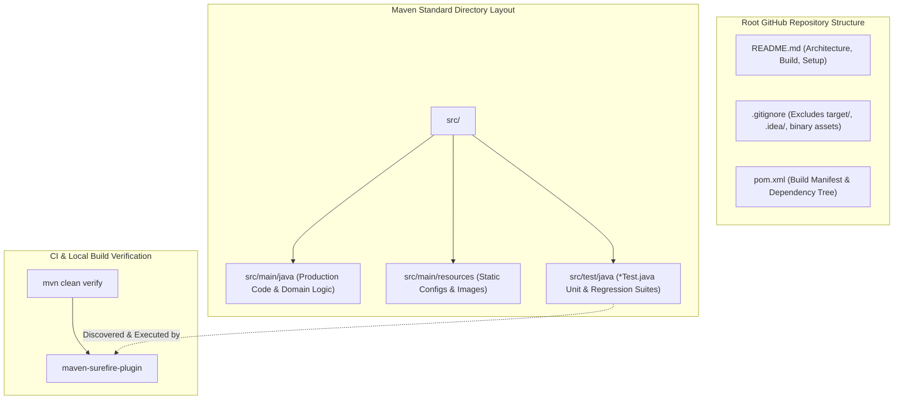
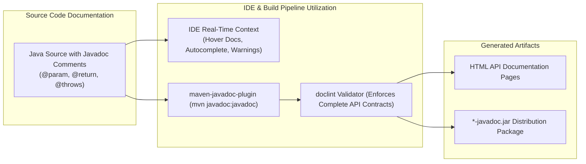
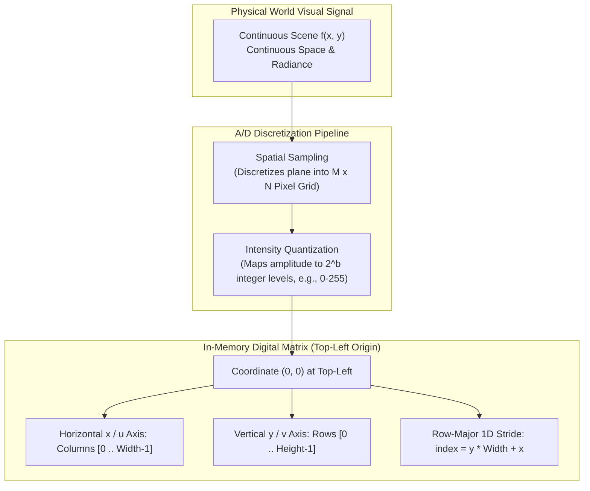
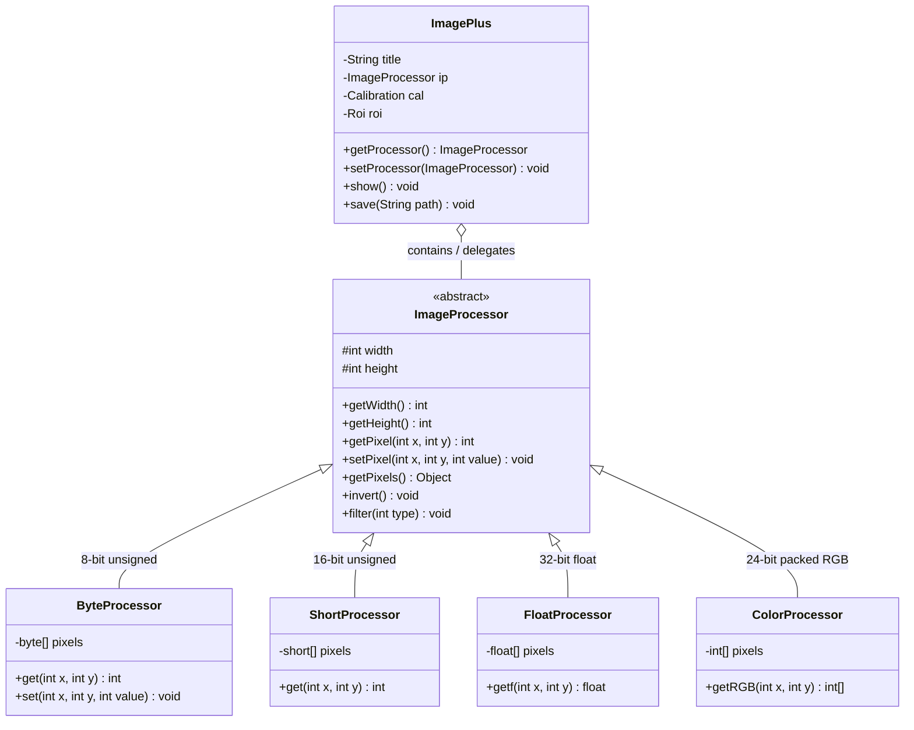

# 📝 Class Notes

### Topic 1: Professional GitHub Repository Standards — Structural `README.md`, Maven Layout, and Test Suite Rigor
In enterprise and academic software engineering, a GitHub repository serves not merely as a remote code archive, but as a self-documenting, reproducible software product. A professional repository strictly follows standard directory layouts—specifically the Maven Standard Directory Layout (`src/main/java` for production sources, `src/test/java` for automated unit and integration tests, and `src/main/resources` for auxiliary assets). The `README.md` acts as the primary architectural entry point; it must articulate the project's purpose, operational architecture, prerequisite JDK/tooling versions, build lifecycle commands (`mvn clean compile`, `mvn test`), CI status badges, and contribution workflows. Omitting structured instructions shifts an unsustainable cognitive and operational burden onto downstream developers and evaluators.

Testing hygiene in a professional GitHub repository requires isolated, repeatable test files that validate business logic without external side effects. Automated test suites written using modern frameworks like JUnit 5 (`org.junit.jupiter.api`) must follow deterministic naming conventions (e.g., `*Test.java` or `*IT.java`) so that build automation engines like `maven-surefire-plugin` execute them seamlessly during the default `test` lifecycle phase. Clean repositories maintain strict separation between transient build outputs and source code: compiled artifacts in the `target/` directory, IDE metadata (`.idea/`, `.vscode/`, `.settings/`), and OS-specific files (`.DS_Store`, `Thumbs.db`) must be systematically excluded via a robust `.gitignore` to prevent repository bloat, security leaks, and merge collisions.



### Topic 2: Git Commit Conventions and Semantic Versioning
Version control integrity relies upon atomic, structured commit histories that describe *what* changed and *why* rather than trivial chronological diffs. Adopting standard conventions, such as the Conventional Commits specification, structures each commit header as `<type>(<scope>): <subject>`—utilizing standardized prefixes such as `feat:` for net-new functionality, `fix:` for defect resolutions, `docs:` for documentation updates, `test:` for adding or refactoring test suites, and `refactor:` for internal structural enhancements without behavioral mutation. This semantic discipline facilitates automated changelog generation, accelerates code reviews, and provides unambiguous context during `git bisect` debugging operations.

Moreover, linking commit histories to Semantic Versioning (`MAJOR.MINOR.PATCH`) guarantees predictability across releases. A breaking API change demands a MAJOR version increment, backwards-compatible feature additions trigger a MINOR increment, and defect fixes increment the PATCH level. Maintaining atomic commits—where each commit encapsulates exactly one logical, compiling unit of work—prevents intermediate broken states in Git branches, enables clean rebasing workflows, and ensures continuous integration (CI) runners validate stable, bisectable states at every push or pull request.

### Topic 3: The Critical Role of Javadoc in API Contracts and Automated Verification
Javadoc is the foundational mechanism for establishing unambiguous, machine-readable API contracts in Java ecosystems. Rather than writing ad-hoc inline comments that explain implementation quirks, Javadoc comments (`/** ... */`) document public and protected interfaces, classes, constructors, and methods from the consumer's perspective. Standard tags—including `@param` for formal parameter semantics and valid domains, `@return` for output invariants and sentinel values, `@throws` or `@exception` for declared runtime and checked exceptions under defined pre-conditions, and `@see` / `@since` for cross-references and versioning—explicitly document class behavior, thread safety, and nullability expectations.

From a software engineering perspective, comprehensive Javadoc directly accelerates developer onboarding and IDE efficiency by driving contextual code completions, parameter tooltips, and hover documentation in environments such as IntelliJ IDEA and VS Code. In enterprise continuous integration pipelines, documentation completeness is enforced deterministically through the `maven-javadoc-plugin`. The compiler's `doclint` tool validates documentation syntax, broken cross-references, missing tags, and malformed HTML, allowing build pipelines to fail fast when public API contracts are neglected or incomplete.



### Topic 4: Introduction to Digital Image Processing & Burger and Burge's Algorithmic Framework
Digital Image Processing (DIP) is the algorithmic manipulation of multidimensional visual signals using general-purpose computing systems to enhance visual quality, extract quantitative data, or prepare pictorial representations for downstream machine vision tasks. Unlike human biological perception—which dynamically adjusts for illumination and contextual semantics—computational image processing treats visual information as numerical matrices subject to linear algebra, statistical analysis, and signal processing transformations. Core operations span point operations (intensity re-mapping and histogram equalization), spatial filtering (linear neighborhood convolutions for blurring or sharpening), morphological transformations, and frequency-domain transformations (Discrete Fourier Transform).

The academic foundation of this discipline in Java is articulated in Wilhelm Burger and Mark J. Burge's seminal textbook, *Digital Image Processing: An Algorithmic Introduction Using Java* (Springer). Burger and Burge bridge theoretical mathematics and concrete software engineering by using Java as the algorithmic vehicle, demonstrating how complex mathematical operations—such as discrete convolution filters, gradient edge detectors (Sobel, Prewitt), and color-space conversions (RGB, HSB, CIELab)—translate into clean, high-performance object-oriented code. Crucially, Burger and Burge structure their implementations around the ImageJ platform, establishing it as the standard pedagogical and research workbench for translating mathematical image operators into functional plugins.

### Topic 5: Discrete Image Fundamentals — Sampling, Quantization, and Coordinate Geometry
A continuous physical scene $f(x, y)$ is transformed into a digital image through two distinct spatial and amplitude discretization processes: **spatial sampling** and **intensity quantization**. Spatial sampling discretizes the continuous 2D spatial coordinate plane into an $M \times N$ orthogonal grid of discrete spatial elements, known as **pixels** (picture elements), where $M$ represents image height (rows) and $N$ represents image width (columns). Quantization converts continuous spectral radiance into discrete digital values (intensity levels) bounded by the bit depth $b$, yielding $K = 2^b$ possible quantized levels (for instance, an 8-bit grayscale image constrains pixel luminance to integer values within the closed set $[0, 255]$).

The mathematical coordinate convention in digital image processing diverges from standard Cartesian coordinate systems. The coordinate origin $(0, 0)$ is fixed at the top-left corner of the image plane; the horizontal axis $u$ (or $x$) increments positively from left to right spanning columns $[0, \text{width} - 1]$, while the vertical axis $v$ (or $y$) increments positively downwards spanning rows $[0, \text{height} - 1]$. In computer memory, this two-dimensional spatial matrix $I(x, y)$ is typically flattened into a contiguous one-dimensional linear array (row-major order) to optimize CPU cache locality, where the 1D array index for a given coordinate is computed via the row-major stride formula: $\text{index} = y \times \text{width} + x$.



### Topic 6: The ImageJ Architecture — `ImagePlus` and the `ImageProcessor` Hierarchy
Developed by Wayne Rasband at the National Institutes of Health (NIH), ImageJ is an open-source, extensible Java platform designed specifically for biomedical imaging, computer vision, and scientific signal processing. ImageJ decouples the visual presentation, windowing, and metadata container from the underlying mathematical pixel arrays through a modular object-oriented hierarchy. The primary high-level container is `ij.ImagePlus`, which encapsulates image metadata, file path information, calibration coordinates, Region of Interest (`ij.gui.Roi`), and one or more slices. However, all mathematical calculations, pixel manipulations, and filter convolutions are delegated to an abstract processing engine: `ij.process.ImageProcessor`.

The `ImageProcessor` abstraction specializes into concrete subclasses based on bit depth and photometric interpretation: `ByteProcessor` (8-bit grayscale or indexed color, utilizing `byte[]`), `ShortProcessor` (16-bit unsigned grayscale, utilizing `short[]`), `FloatProcessor` (32-bit floating-point precision for scientific dynamic range, utilizing `float[]`), and `ColorProcessor` (24-bit RGB packed into `int[]`). This polymorphic separation allows algorithms to operate either at high-level abstractions using methods like `getPixel(x, y)` and `setPixel(x, y, val)`, or directly on native primitive arrays via `getPixels()` for maximum computational throughput. Furthermore, ImageJ natively supports headless execution, enabling complex batch processing pipelines, automated filter chains, and image analyses to execute in automated server environments without instantiating graphical AWT/Swing windows.



### Topic 7: Integrating ImageJ as a Maven Library Dependency via `pom.xml`
Historically distributed as a standalone desktop application with an embedded Java runtime and manual plugin directories, modern software engineering best practices incorporate ImageJ directly into build pipelines as an external library dependency. While standard Maven Central hosts the core package under `net.imagej:ij`, advanced scientific imaging workflows often leverage the SciJava / ImageJ Maven repository (`https://maven.scijava.org/content/repositories/public/`) to resolve complementary modules, Fiji extensions, and hardware I/O adapters. Declaring the dependency in `pom.xml` standardizes compilation and guarantees deterministic classpath resolution across team development environments and CI systems.

To embed ImageJ 1.x into a Maven project, developers declare the artifact coordinates within the `<dependencies>` block of `pom.xml`. Specifying `<groupId>net.imagej</groupId>`, `<artifactId>ij</artifactId>`, and an active version (such as `1.54f` or latest stable release) automatically pulls the core engine into the project's compile classpath without manual `.jar` installation:

```xml
<dependency>
    <groupId>net.imagej</groupId>
    <artifactId>ij</artifactId>
    <version>1.54f</version>
</dependency>
```

When deployed in programmatic, non-GUI environments, developers can utilize helper classes such as `ij.IJ` to invoke static utility routines (e.g., `IJ.openImage(path)`), execute pixel transformations via `ImageProcessor`, and persist processed matrices using `IJ.save(imagePlus, path)`. This programmatic workflow eliminates GUI event loop overhead, decouples image manipulation routines from interactive desktop shells, and enables robust, automated unit testing of image processing filters via JUnit.

---

# 💡 Class Reflection — 22/10/26
- **Topics Covered**: Professional GitHub Repository Standards, Git Commit Conventions & Semantic Versioning, Javadoc & Automated API Verification, Digital Image Processing & Burger's Book, Discrete Image Sampling & Coordinate Systems, ImageJ Architecture (`ImagePlus` & `ImageProcessor`), Maven Dependency Integration for ImageJ.
- **Reflections**:
  - Structuring repositories with clear `README.md` guidelines and isolating test suites in `src/test/java` ensures immediate reproducibility across diverse development environments.
  - Adhering to Conventional Commits and Semantic Versioning creates bisectable, audit-ready version histories essential for automated release pipelines.
  - Comprehensive Javadoc acts as an enforceable API contract, preventing misinterpretation of edge cases and failing fast during CI build verification via `doclint`.
  - Digital image processing translates continuous optical signals into discrete linear algebra problems, with Burger and Burge providing the foundational algorithmic bridge in Java.
  - Mapping 2D image coordinates from a top-left origin into flattened 1D row-major arrays optimizes memory bandwidth and CPU cache locality during filter convolutions.
  - The architectural decoupling between `ImagePlus` and the `ImageProcessor` hierarchy enables high-throughput primitive array mutations alongside headless server execution.
  - Declaring ImageJ as a declarative Maven dependency in `pom.xml` eliminates fragile manual JAR bundling and integrates scientific imaging directly into reproducible CI/CD pipelines.
