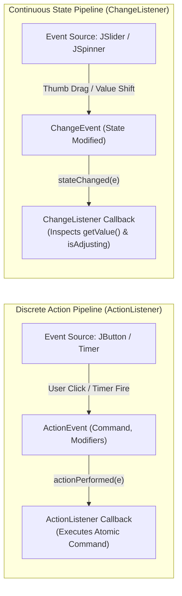
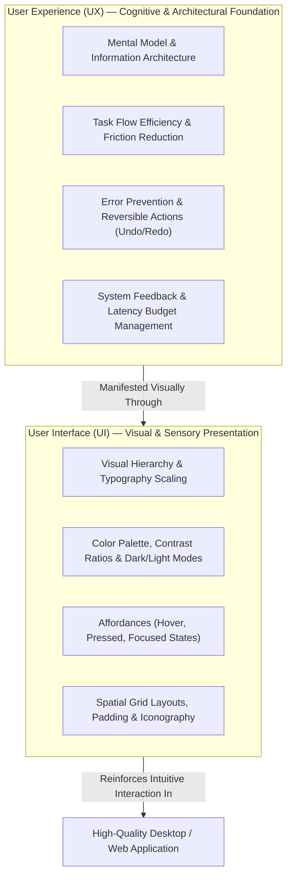
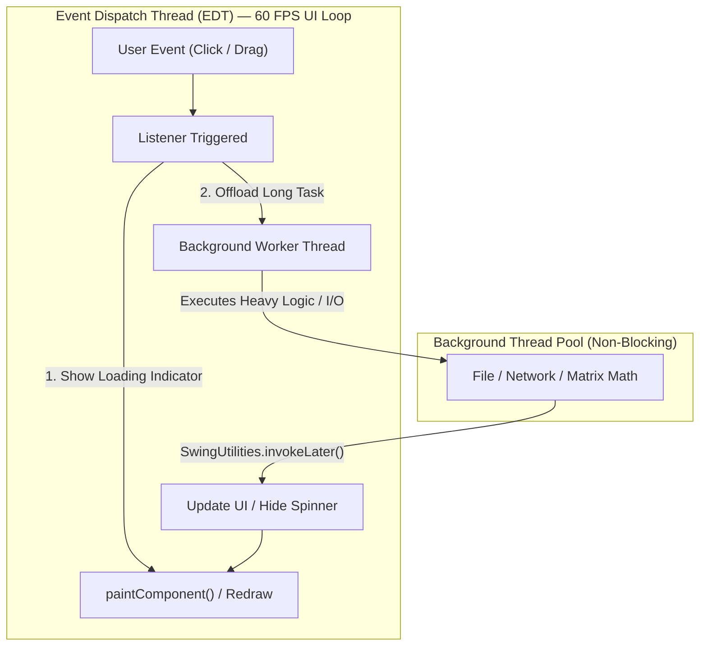

# 📝 Class Notes

### Topic 1: Java Interfaces as Architectural Contracts — Abstraction, Polymorphism, and Interface Evolution
In object-oriented software engineering, an interface defines an unambiguous behavioral contract without dictating implementation specifics. Unlike concrete or abstract classes—which may encapsulate mutable instance state, constructors, and partial algorithmic implementations—a Java `interface` establishes an API boundary that decouples caller specifications from provider implementations. A class implementing an interface pledges to satisfy all declared method contracts, enabling runtime polymorphism where consumers interact exclusively with abstract interfaces (e.g., `List<T> list = new ArrayList<>()`) rather than binding tightly to concrete implementations. This architectural decoupling facilitates unit testing with mock implementations, minimizes compilation dependencies, and permits multi-inheritance of type signatures without the diamond problem associated with multiple class inheritance.

The design of Java interfaces evolved substantially with the introduction of Java 8 and Java 9. Historically, altering an interface by introducing a new method caused catastrophic binary incompatibilities across all downstream implementers. Java 8 mitigated this through **default methods** (`default` keyword) and **static interface methods**, allowing library designers to enrich existing API contracts with non-breaking default behaviors (such as `Iterable.forEach()` or `Collection.stream()`). Java 9 further expanded this by permitting **private methods** within interfaces, enabling internal helper method extraction without exposing implementation details to public consumers. Crucially, single-method interfaces—termed **Functional Interfaces** and annotated with `@FunctionalInterface`—form the backbone of modern Java's declarative programming paradigm, enabling developers to satisfy Single Abstract Method (SAM) contracts cleanly via lambda expressions (`->`) and method references (`::`).

```mermaid
flowchart TD
    subgraph ContractLayer ["Interface Contract Specification"]
        IFACE["«interface»<br/>Contract / Listener<br/>+abstractMethod(): void<br/>+defaultMethod(): void<br/>+staticUtility(): void"]
    end
    subgraph ImplementationLayer ["Polymorphic Implementations"]
        C1["ConcreteClassA<br/>(Specific Logic A)"]
        C2["ConcreteClassB<br/>(Specific Logic B)"]
        LAMBDA["Lambda Expression<br/>(Inline Functional SAM)"]
    end
    subgraph ClientLayer ["Consumer / Caller (Decoupled)"]
        CLIENT["UI Framework / Event Bus<br/>Interacts strictly via Interface Reference"]
    end
    IFACE <|.. C1
    IFACE <|.. C2
    IFACE <|.. LAMBDA
    CLIENT -->|"Invokes contract method"| IFACE
```

### Topic 2: Event-Driven Programming & Delegation Event Model — `ActionListener` vs. `ChangeListener`
Graphical user interfaces in Java are fundamentally event-driven, operating on the **Delegation Event Model**. Under this architectural pattern, visual components act as **Event Sources** that generate **Event Objects** in response to user manipulation, subsequently broadcasting these objects to registered **Event Listeners** implementing specific callback interfaces. The two most prominent listener contracts in standard Java GUI programming are `java.awt.event.ActionListener` and `javax.swing.event.ChangeListener`, each tailored to fundamentally different interaction semantics:

1. **`ActionListener` & `ActionEvent` (Discrete Intent)**:
   * **Semantic**: Represents discrete, completed, or atomic user commands and triggers.
   * **Typical Sources**: `JButton` clicks, `JMenuItem` selections, pressing the Enter key inside a `JTextField`, or the periodic firing of a `javax.swing.Timer`.
   * **Contract**: Enforces a single callback method: `void actionPerformed(ActionEvent e)`.
   * **Data Carried**: The `ActionEvent` object carries metadata including an action command string (`e.getActionCommand()`), keyboard modifier flags (`e.getModifiers()`), and execution timestamps (`e.getWhen()`).
2. **`ChangeListener` & `ChangeEvent` (Continuous State Mutation)**:
   * **Semantic**: Represents continuous, progressive, or fine-grained property transitions.
   * **Typical Sources**: Dragging the thumb knob of a `JSlider`, incrementing/decrementing a `JSpinner`, switching active tabs in a `JTabbedPane`, or mutations in a `BoundedRangeModel`.
   * **Contract**: Enforces a single callback method: `void stateChanged(ChangeEvent e)`.
   * **Data Carried**: A `ChangeEvent` carries minimal state, merely notifying listeners that an internal property has mutated; consumers query the source directly (e.g., `JSlider slider = (JSlider) e.getSource()`) and inspect transient flags such as `slider.getValueIsAdjusting()` to avoid thrashing rendering engines during continuous mouse drags.

In modern JavaFX applications, this distinction maps seamlessly to `EventHandler<ActionEvent>` on controls like `ButtonBase` versus observable property observers implementing `javafx.beans.value.ChangeListener<T>`, where listeners receive `(observable, oldValue, newValue)` triplets for reactive model synchronization.



### Topic 3: User Interface (UI) vs. User Experience (UX) Engineering Principles
Developing software products demands a clear distinction and rigorous synthesis between **User Interface (UI)** design and **User Experience (UX)** engineering. While frequently conflated, they address distinct layers of human-computer interaction:
* **User Interface (UI)** encompasses the sensory, visual, and tactile presentation layer of the application. It governs aesthetic tokens: color harmony, contrast ratios adhering to accessibility standards (such as WCAG AA/AAA guidelines), typography hierarchy, spatial padding, grid alignments, visual weight, and explicit control iconography. UI ensures the visual environment is clean, professional, and visually coherent.
* **User Experience (UX)** encompasses the user's holistic cognitive journey, mental model alignment, efficiency, and emotional satisfaction when interacting with the system. UX dictates task flows, interaction latency, cognitive load reduction, error prevention, feedback mechanisms, and system predictability.

Effective UI/UX design is anchored in fundamental cognitive principles:
1. **Affordances and Signifiers**: Visual components must communicate how they operate through their visual design. A button must look pressable (raised borders, subtle drop shadows, hover state transitions), while draggable elements must provide appropriate spatial cues and cursor transitions (e.g., `Cursor.getPredefinedCursor(Cursor.HAND_CURSOR)` or `MOVE_CURSOR`).
2. **Immediate Feedback & Latency Budgets**: According to Jakob Nielsen's response-time heuristics, visual acknowledgement of user interaction must occur within **100 milliseconds** to feel instantaneous. Actions spanning between 0.1 and 1.0 second maintain uninterrupted thought flow, whereas operations exceeding 1.0 second demand explicit visual progress indicators (such as `JProgressBar`, indefinite spinners, or status bar notifications) to avoid user disorientation.
3. **Error Tolerance & Forgiveness**: Systems should prevent invalid states through smart input constraints (e.g., disabling buttons until prerequisite fields are validated) and provide painless recovery mechanisms, such as atomic undo/redo operations via the Command Design Pattern.



### Topic 4: Concurrency, Thread Safety, and the Event Dispatch Thread (EDT) in UI/UX
A critical intersection of software architecture and UX fidelity is thread scheduling and GUI concurrency. Java's Swing and AWT frameworks are strictly **single-threaded subsystems**. All component instantiation, hierarchy manipulation, event listener execution, and visual rendering operations must execute exclusively on a dedicated thread: the **Event Dispatch Thread (EDT)** (and correspondingly, the JavaFX Application Thread in JavaFX).

Violating this architectural rule by executing long-running operations—such as heavy computational algorithms, network I/O, file access, or database queries—directly inside an `ActionListener` or `ChangeListener` blocks the EDT. Because the EDT is simultaneously responsible for processing mouse/keyboard events and painting the screen via `paintComponent()`, blocking it causes the entire application window to freeze, stop repainting, and manifest the dreaded operating system "Not Responding" state. This catastrophic failure of UX destroys user trust and corrupts interactive dynamics.

To maintain a fluid, responsive 60 FPS user interface, developers must offload resource-intensive workloads to background worker threads using abstractions such as `javax.swing.SwingWorker<T, V>`, `CompletableFuture`, or JavaFX `Task<T>`. Once background computation finishes, state mutations must be synchronized safely back to the EDT using `SwingUtilities.invokeLater(Runnable)` or `Platform.runLater(Runnable)`. This pattern enforces non-blocking user feedback, allows responsive progress cancellation, and guarantees thread-safe model-to-view synchronization.



---

# 💡 Class Reflection — 27/10/26
- **Topics Covered**: Java Interfaces as Architectural Contracts, Default & Static Methods in Interfaces, Functional Interfaces & Lambdas, Delegation Event Model, `ActionListener` vs. `ChangeListener`, UI Design vs. UX Engineering Principles, Affordances and Feedback Latency, Event Dispatch Thread (EDT) Concurrency & Responsive Background Work.
- **Reflections**:
  - Designing against Java interfaces rather than concrete classes establishes modular API boundaries, enabling clean dependency inversion and frictionless unit testing.
  - The evolution of interfaces with default and static methods allows backward-compatible library evolution, while functional interfaces provide an elegant foundation for lambda-based event callbacks.
  - Distinguishing between discrete command events (`ActionListener`) and continuous property mutations (`ChangeListener`) prevents unnecessary computational churn during real-time user manipulation.
  - UI provides aesthetic visual coherence, whereas UX structures cognitive task flows and system predictability; exceptional software requires equal rigor across both disciplines.
  - Maintaining responsive UI/UX requires strict adherence to single-threaded EDT rules, delegating latency-heavy tasks to background workers while marshaling state updates back via `SwingUtilities.invokeLater()`.
